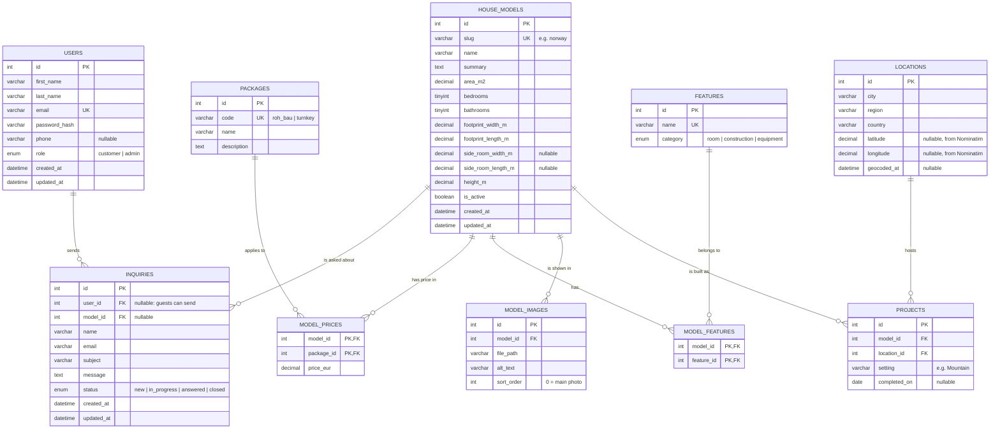

# Database Plan (Draft)

> **Status:** Draft for Milestone 1 (planning only). No tables have been created yet. Names and columns may change when the backend is built.

The A-Frame Living database (MySQL, accessed from PHP through PDO) stores the house models and their prices, photos and features, the completed projects and their locations, customer inquiries, and user accounts for the two roles.

## Entities at a Glance

| # | Table | What it stores |
|---|---|---|
| 1 | `users` | Accounts for customers and administrators |
| 2 | `house_models` | The four A-frame models (Atlantic, Norway, Scandinavia, Continental) |
| 3 | `packages` | The two packages every model is sold in: ROH BAU and Turnkey |
| 4 | `model_prices` | The price of each model in each package (links models and packages) |
| 5 | `features` | Rooms and features, e.g. "Kitchen", "Laminated timber", "Fireplace" |
| 6 | `model_features` | Which model has which feature (links models and features) |
| 7 | `model_images` | Photos of each model, in display order |
| 8 | `locations` | Places where houses have been built, with map coordinates |
| 9 | `projects` | Completed builds: which model was built at which location |
| 10 | `inquiries` | Messages sent through the contact form |

The **main entities** with their own CRUD screens are `users`, `house_models`, `packages`, `features`, `locations`, `projects` and `inquiries`. `model_prices`, `model_features` and `model_images` belong to a house model and are managed on its admin screen.

## Entity-Relationship Diagram

GitHub and VS Code's Markdown preview draw this as a diagram. `PK` = primary key, `FK` = foreign key, `UK` = unique.

## Relationships

| Relationship | Type | Meaning |
|---|---|---|
| `users` → `inquiries` | one-to-many, optional | A logged-in customer can send many inquiries. Guests can also send inquiries, so `user_id` may be empty. If a user is deleted, their inquiries are kept (`ON DELETE SET NULL`). |
| `house_models` → `inquiries` | one-to-many, optional | An inquiry may be about one specific model (e.g. "Inquire about Norway"). |
| `house_models` ↔ `packages` via `model_prices` | many-to-many | Every model has a price in every package. The price is stored on the link (`price_eur`). |
| `house_models` ↔ `features` via `model_features` | many-to-many | A model has many features, and a feature (e.g. "Laminated timber") can belong to many models. |
| `house_models` → `model_images` | one-to-many | A model has many photos; `sort_order = 0` is the main photo. Deleting a model deletes its photos (`ON DELETE CASCADE`). |
| `house_models` → `projects` | one-to-many | A model has been built at many places (Norway: 11 projects). A model with projects cannot be deleted (`ON DELETE RESTRICT`); it can be set to `is_active = 0` instead. |
| `locations` → `projects` | one-to-many | A location can host several projects over time. |

## Keys and Constraints

- Every table has an `id INT UNSIGNED AUTO_INCREMENT` primary key, except the two link tables. Those use a composite primary key (`model_id, package_id` and `model_id, feature_id`), so the same pair can't be stored twice.
- Unique: `users.email`, `house_models.slug`, `packages.code`, `features.name`, and the pair `locations.city + locations.country`.
- Money is stored as `DECIMAL(10,2)` in euros, and sizes as `DECIMAL(6,2)` in m or m². Never `FLOAT`, so there are no rounding errors.
- Passwords are stored only as `password_hash()` hashes, never in plain text.
- Text columns use `utf8mb4`, so place names like *Bihać*, *Šipovo* and *Brčko* are stored correctly.
- Values allowed in `role` and `status` are limited with `ENUM`.

## Roles and Permissions

The application has two roles, plus visitors who are not logged in. Authentication and authorization will use JWT (backend phase).

| Entity | Guest (not logged in) | Customer | Admin |
|---|---|---|---|
| `users` | Register | Read and update own profile | Full CRUD, change roles |
| `house_models` (with prices, features, images) | Read active models | Read active models | Full CRUD |
| `packages` | Read | Read | Full CRUD |
| `features` | Read | Read | Full CRUD |
| `locations` | Read | Read | Full CRUD (+ trigger geocoding) |
| `projects` | Read | Read | Full CRUD |
| `inquiries` | Create | Create; read own | Read all, update status, delete |

## External API: OpenStreetMap Nominatim

- **Feature:** an interactive map with a pin for every completed project, shown at the top of the **Locations** page. Today a placeholder panel marks where it will appear.
- **How:**
  1. When an admin adds or edits a location, the PHP backend asks Nominatim (`https://nominatim.openstreetmap.org/search`) for the coordinates of "city, country".
  2. The result is saved in `locations.latitude` / `longitude` / `geocoded_at`, so Nominatim isn't called on every page view.
  3. The frontend receives the coordinates from our own REST API and draws the map with OpenStreetMap tiles (e.g. with the Leaflet library).
- **Failures:**
  - The request has a short timeout.
  - Error responses and timeouts are written to `backend/logs/error.log`.
  - The admin sees a friendly message.
  - The location is saved without coordinates.
  - The Locations page still lists every project, and the map simply leaves out places without coordinates.
- Nominatim's usage policy (identifying User-Agent, at most 1 request per second) is respected by geocoding only on save.

## Where Today's Static Data Will Live

The Milestone 1 frontend still reads from static files. In the backend phase each file is replaced by calls to the REST API:

| Static file (today) | Table(s) |
|---|---|
| `frontend/js/data/houses.js` | `house_models`, `model_prices`, `model_features` + `features`, `model_images` |
| `frontend/js/data/packages.js` | `packages` (the "who does what" list can become a column or a small extra table later) |
| `frontend/js/data/locations.js` | `locations`, `projects` |
| Contact form (`frontend/js/services/inquiries.js`) | `inquiries` |
| `frontend/js/data/demo.js` (example users and inquiries for the static Profile/Admin preview) | `users`, `inquiries` |
| `frontend/js/data/faq.js`, `company.js` | Static site content. TODO: decide whether they also become tables, because the brief asks that no hard-coded data is left in the final frontend. |

Logs are planned as files (`backend/logs/info.log`, `backend/logs/error.log`), not as a table.

## Draft REST Endpoints (planning notes)

| Method and path | Who | Purpose |
|---|---|---|
| `POST /auth/register`, `POST /auth/login` | Guest | Create an account; log in and receive a JWT |
| `GET /users/me`, `PUT /users/me` | Customer | Own profile |
| `GET /users`, `PUT /users/{id}`, `DELETE /users/{id}` | Admin | Manage users |
| `GET /houses`, `GET /houses/{slug}` | Everyone | Models with prices, features and images |
| `POST /houses`, `PUT /houses/{id}`, `DELETE /houses/{id}` | Admin | Manage models (prices, features and images as sub-resources) |
| `GET /packages`, `POST`/`PUT`/`DELETE /packages/{id}` | Everyone / Admin | Packages |
| `GET /features`, `POST`/`PUT`/`DELETE /features/{id}` | Everyone / Admin | Features |
| `GET /locations`, `POST`/`PUT`/`DELETE /locations/{id}` | Everyone / Admin | Locations (POST/PUT trigger geocoding) |
| `GET /projects`, `POST`/`PUT`/`DELETE /projects/{id}` | Everyone / Admin | Completed projects |
| `POST /inquiries` | Guest, Customer | Send an inquiry |
| `GET /inquiries/mine` | Customer | Own inquiries |
| `GET /inquiries`, `PATCH /inquiries/{id}`, `DELETE /inquiries/{id}` | Admin | Manage inquiries and their status |

These will be documented with OpenAPI (Swagger) in the backend phase.
